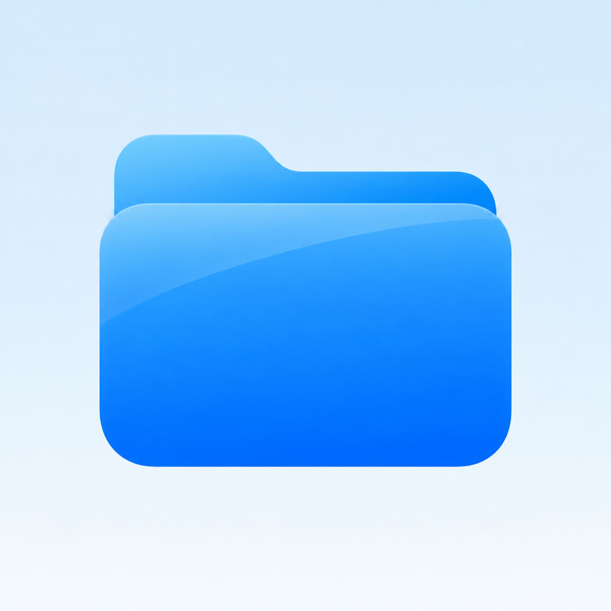
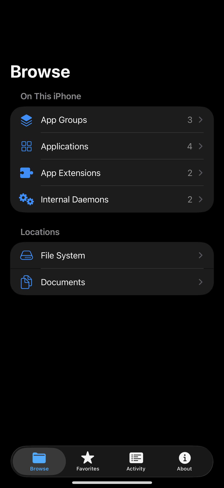
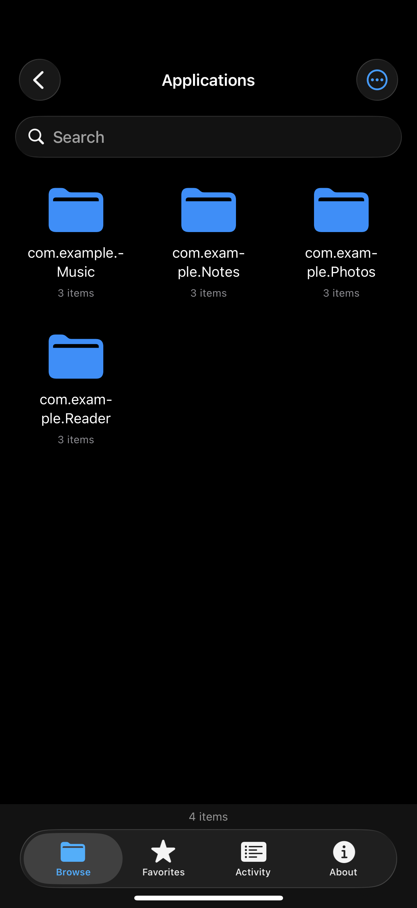
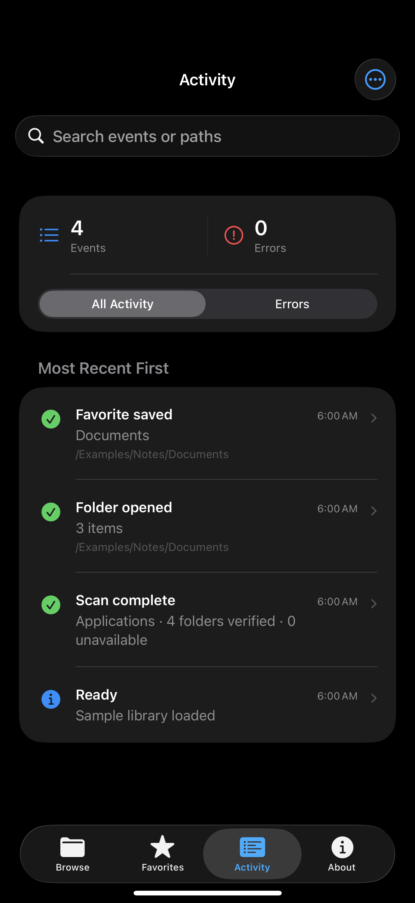
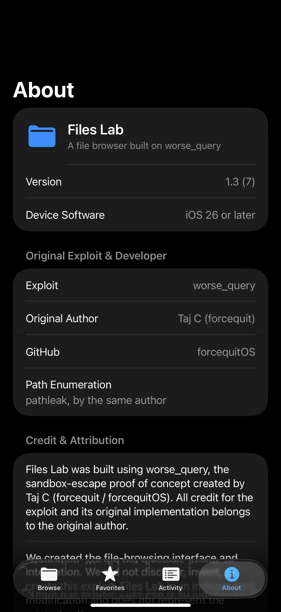
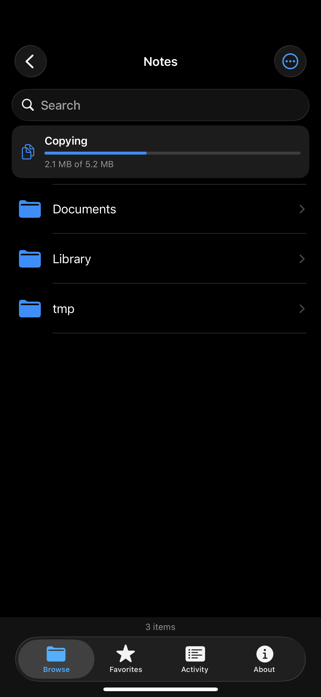
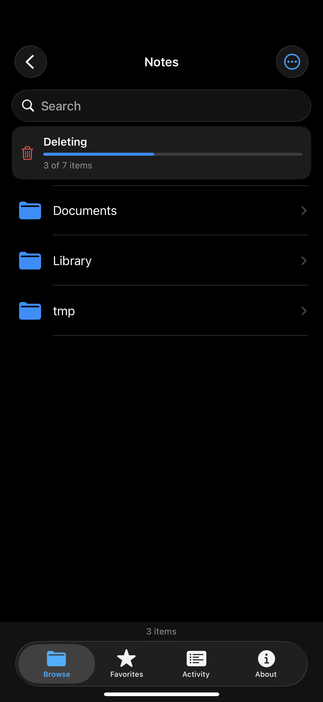

<p align="center"></p>

# Files Lab

A native-style iOS file browser built with SwiftUI, using **[worse_query](https://github.com/forcequitOS/worse_query)** by **[Taj C (forcequit / forcequitOS)](https://github.com/forcequitOS)**.

**All credit for the exploit, its original implementation, and `pathleak` enumeration belongs to the original author.** Files Lab adds the browsing interface and integration. We did not discover, invent, or create the exploit. This is an independent modification and does not represent the original author.

[GPL-3.0-or-later](LICENSE) · [Attribution](NOTICE.md) · [Contributing](CONTRIBUTING.md)

## Screenshots

These screenshots were captured from the app with its **sample-data mode** enabled. They contain no personal device inventory, signing details, or real container paths.

| Browse | Icons view |
| --- | --- |
|  |  |

| Activity | About and credits |
| --- | --- |
|  |  |

| Copy progress | Move progress | Delete progress |
| --- | --- | --- |
|  |  |  |

## Features

- **Browse:** App Groups, Applications, App Extensions, Internal Daemons, and accessible filesystem locations.
- Standard folder navigation with native Back behavior.
- List and adaptive icon-grid layouts, with full names in the grid.
- Pinned search; Name, Kind, Date, and Size sorting; ascending/descending order; folders-first and hidden-file options.
- **Favorites:** persistent shortcuts to folders.
- **Activity:** searchable event history, an Errors filter, event details, timings, and text export.
- Native Quick Look previews and sharing.
- Copy/paste, Move Here, rename, permanent deletion, new folders, and file import with Keep Both/Replace conflict handling in writable locations.
- One top progress card with a distinct icon for copy, move, and delete; live byte progress for large copies, item-count progress for folder deletion, and smooth folder-row transitions after changes.
- Cached discovery and bounded directory/log caches.
- **About:** original author credits, source links, and the bundled GPL license.

Access depends on the underlying PoC and the running iOS version. Some filesystem paths remain inaccessible. A successful directory read does not imply write access: file actions can still be denied by iOS. Cross-container creation was denied in one physical-device check even though reading worked. Size sorting uses file byte sizes and known container item counts; it does not recursively calculate folder byte totals.

## Managing files

Inside a folder:

- Touch and hold a file or folder for **Copy**, **Move**, **Rename**, **Share**, and **Delete**.
- After choosing Copy or Move, navigate to the destination and use **••• → Paste** or **Move Here**.
- Use **••• → New Folder** or **Import File…** to add content.
- A name conflict offers **Keep Both**, **Replace**, or **Cancel**. Replace is limited to files; it never merges or replaces folders.
- Delete requires confirmation and permanently removes the selected item and its contents. There is no Recently Deleted recovery feature.

File copies are streamed in bounded chunks and staged in the destination directory. Existing-file replacement uses a same-directory atomic rename after the staged copy succeeds; the original remains until the new copy is ready. Move copies to the destination first, then removes the source; if source removal fails, both locations require review. Folder deletion counts entries first, then reports how many have been removed. Errors are shown and recorded in Activity. These actions do not bypass additional iOS write restrictions.

## Original project and provenance

The exploit and enumeration implementation come from [forcequitOS/worse_query](https://github.com/forcequitOS/worse_query), based on revision [`d1540e2`](https://github.com/forcequitOS/worse_query/tree/d1540e20cd82b974d891e0551ced6d6aeb570ac2).

The upstream Objective-C exploit and `pathleak` files retain their original copyright and license notices. Files Lab adds SwiftUI browsing, navigation, presentation, favorites, activity, screenshots, and configurable build settings. See [NOTICE.md](NOTICE.md) for the attribution and modification notice.

The upstream README describes targets as iOS 26.0–26.7.2 / 27.2. That is the upstream claim, not a guarantee of support for every device or build. Upstream also explicitly states that this PoC is not a jailbreak.

## Build and run

### Requirements

- macOS with Xcode 26.2 or later and an iOS SDK.
- A physical iPhone or iPad for meaningful exploit testing.
- Your own Apple signing team, app identifier, registered App Group, and a profile that permits that group.
- Developer Mode and pairing/trust configured on the device.

No signing certificates, profiles, passwords, or device identifiers are included.

### Configure your own signing

1. Open `worse_query.xcodeproj` and select the `worse_query` scheme. The upstream project/target names are retained for provenance; the app is displayed as **Files Lab**.
2. Under **Signing & Capabilities**, select your own team and replace `com.example.FilesLab` with a bundle identifier you control.
3. Register an App Group for that app. In the target's **Build Settings → User-Defined**, set `APP_GROUP_IDENTIFIER` to the exact group identifier your profile permits.
4. Confirm the App Groups entitlement resolves to that same identifier. The checked-in entitlement uses `$(APP_GROUP_IDENTIFIER)`, and the runtime reads the value from the generated Info.plist.
5. Select your connected device and run.

An arbitrary signature alone is insufficient: the provisioning profile must permit the configured App Group.

### Compile without signing

```sh
Tools/BuildUnsigned.sh
```

This produces `build/Build/Products/Debug-iphoneos/worse_query.app`. An unsigned build cannot be installed on a stock iPhone. Use Xcode with your own signing configuration to produce an installable build.

### Make a shareable unsigned IPA

```sh
Tools/PackageUnsignedIPA.sh
```

This creates `build/FilesLab-unsigned.ipa` from a fresh unsigned iOS build. It contains generic `com.example.FilesLab` and `group.com.example.FilesLab` placeholders, no embedded provisioning profile, and no code signature.

Before signing that IPA for a different Apple account, configure **both** identifiers to match an app and App Group permitted by that person's provisioning profile:

```sh
Tools/ConfigureUnsignedIPA.sh \
  build/FilesLab-unsigned.ipa \
  com.yourname.FilesLab \
  group.com.yourname.FilesLab \
  build/FilesLab-configured-unsigned.ipa
```

The result is still unsigned. Sign it with a tool that embeds the matching provisioning profile and signs every executable in the app bundle, then install the signed output. A profile that does not permit the configured App Group may allow installation but the exploit's group query will fail at runtime. If the signing tool cannot configure the required entitlements, build and sign from source in Xcode instead.

### Install a build you have already signed

```sh
Tools/InstallSigned.sh YOUR_DEVICE_ID /absolute/path/to/YourSignedApp.ipa
```

The script also accepts a signed `.app` directory. It does not sign or modify the supplied build.

## Regression checks

```sh
Tools/TestCore.sh
```

This runs the actual file-operation and sorting code against a uniquely named temporary fixture folder. It checks copying, conflicts, atomic replacement, preservation after a failed replacement, keeping both, renaming, deletion, recursive-copy rejection, invalid names, and symlink deletion without deleting its target. Fixture data is removed after the check.

The Debug launch argument `--verify-file-operations` runs the same fixture checks in the app's temporary directory on a physical device. Only disposable test data is changed. In sample-data mode, `--preview-delete-progress`, `--preview-copy-progress`, and `--preview-move-progress` show each progress design without changing any files.

## Screenshot mode

For privacy-safe UI previews, add `--demo-content` to the scheme's **Run → Arguments** in a Debug build. This mode uses sample folders/events, hides the status bar, and avoids reading real container contents or saving sample data over normal history.

Additional Debug launch arguments:

- `--show-activity` — open Activity.
- `--show-about` — open About.
- `--check-icons` — open the Applications sample category in Icons view.
- `--check-pinned-search` — open a long list and scroll to its end for a pinned-search regression check.
- `--verify-view-options` — exercise sorting/filtering regression checks.
- `--verify-browser` — perform real container discovery and a directory round-trip check. This inspects real device metadata and is separate from screenshot mode.

## Privacy and source distribution

The public repository uses a clean source snapshot. It excludes local research exports, device logs, signed IPAs/apps, signing assets, per-user Xcode state, and personal machine paths. The supplied identifiers are generic configuration placeholders. Screenshots use sample data.

The app keeps its discovery cache, favorites, and bounded Activity history locally in its own container. Exporting Activity is a user action; review exported paths before sharing them.

## License

Files Lab is distributed under the **GNU General Public License, version 3 or any later version (`GPL-3.0-or-later`)**, preserving the terms stated in the upstream source headers. See [LICENSE](LICENSE). The original license text is also bundled in the app.

Original exploit/enumeration copyright © 2026 Taj C (forcequit). Files Lab interface and integration modifications © 2026 Files Lab contributors. The software is provided without warranty under the license terms.
